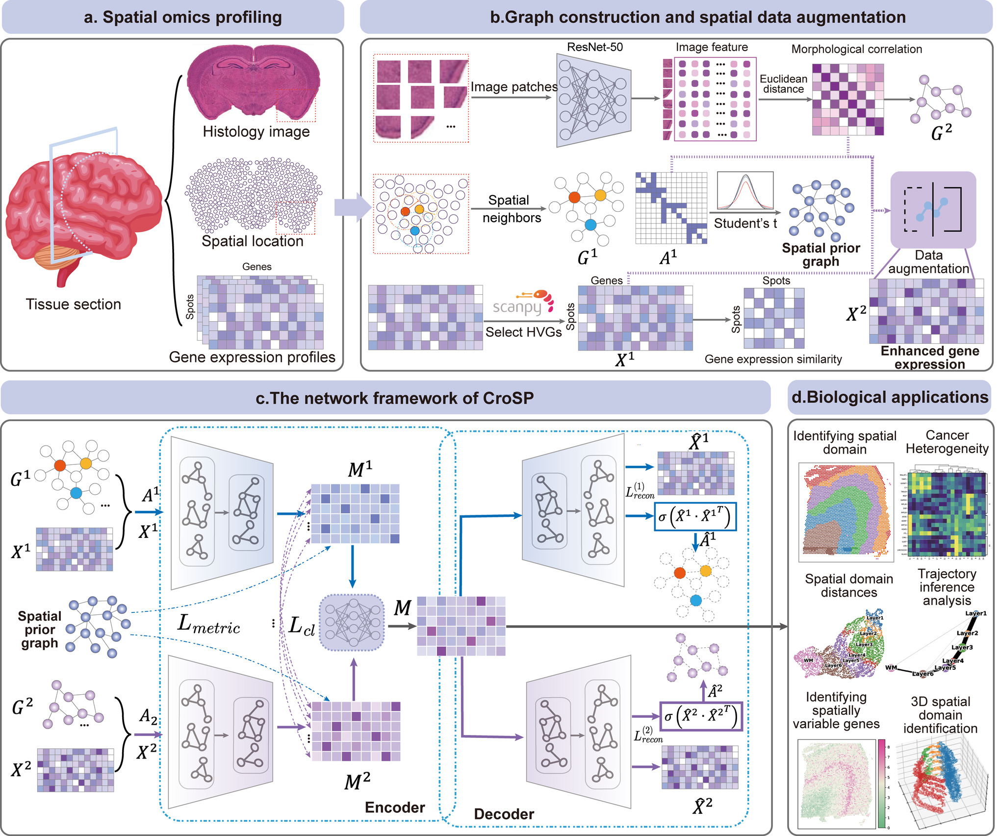

# CroSP

**Deep learning-based enhancing spatial biological context parsing**

CroSP is a deep learning framework for spatial omics analysis. It integrates gene expression, spatial locations, and histological image features, where available, to learn representations for spatial domain identification and downstream biological analysis.

## Table of contents

- [Overview](#overview)
- [Installation](#installation)
- [Data availability](#data-availability)
- [Usage](#usage)
- [Tutorials](#tutorials)
- [Citation](#citation)
- [Contact](#contact)

## Overview



The CroSP workflow includes graph construction and spatial data augmentation, representation learning with a two-branch encoder–decoder network, and downstream applications such as spatial domain identification, analysis of tumor heterogeneity, spatially variable gene identification, and trajectory analysis.

## Installation

CroSP uses Python 3.9 and PyTorch. Create a conda environment before installing the dependencies:

```bash
conda create -n CroSP python=3.9.18
conda activate CroSP
```

The dependency versions used in the original implementation are:

| Dependency | Version |
| --- | --- |
| Python | 3.9.18 |
| PyTorch | 1.13.0+cu116 |
| torch_scatter | 2.1.1 |
| torch_sparse | 0.6.17 |
| Pillow | 9.5.0 |
| pandas | 1.5.3 |
| scanpy | 1.9.2 |
| POT | 0.9.1 |
| scikit-learn | 1.2.1 |
| rpy2 | 3.4.1 |
| R | 4.0.3 |

R and the `mclust` package are needed for analyses using mclust clustering. Install `mclust` in R:

```r
install.packages("mclust")
```

## Data availability

The CroSP data archive is available on Zenodo:

**[Download the data from Zenodo — DOI: 10.5281/zenodo.22658895](https://doi.org/10.5281/zenodo.22658895)**

Download the files needed for the selected dataset and place them at the input paths specified in its analysis script or notebook. The tutorials use prepared data and saved model outputs; they do not download these files automatically.

## Usage

Run the analysis scripts from the repository root. Set the dataset paths and sample identifiers in the selected script before running it.

### DLPFC (10x Visium)

```bash
python analyze_DLPFC.py
```

For downstream analysis and visualization, see [the DLPFC tutorial](Tutorial/analyze_DLPFC.ipynb).

The original example result files for sample 151673 are also available on [Baidu Netdisk](https://pan.baidu.com/s/1Ar4-lOTYRaPATGISBSs26w?pwd=2q6c) (extraction code: `2q6c`).

### osmFISH

```bash
python analyze_osmFISH.py
```

For downstream analysis and visualization, see [the osmFISH tutorial](Tutorial/analyze_osmFISH.ipynb).

The original osmFISH example result files are also available on [Baidu Netdisk](https://pan.baidu.com/s/1CyKDUA4DvHHfn9xmP9yJpg?pwd=yc1q) (extraction code: `yc1q`).

## Tutorials

| Dataset | Notebook |
| --- | --- |
| DLPFC | [analyze_DLPFC.ipynb](Tutorial/analyze_DLPFC.ipynb) |
| osmFISH | [analyze_osmFISH.ipynb](Tutorial/analyze_osmFISH.ipynb) |
| 3D hippocampus | [analyze_3D.ipynb](Tutorial/analyze_3D.ipynb) |
| Chicken heart (D7 and D14) | [analyze_chicken_heart.ipynb](Tutorial/analyze_chicken_heart.ipynb) |

Open the selected notebook in the CroSP environment and follow its cells in order. Update local working-directory and input paths to match your installation.

## Citation

If you use CroSP in your research, please cite:

**Deep learning-based enhancing spatial biological context parsing.** *Bioinformatics* (accepted for publication). DOI: [10.1093/bioinformatics/btag829](https://doi.org/10.1093/bioinformatics/btag829).

When using the shared data, please also cite the [Zenodo data record](https://doi.org/10.5281/zenodo.22658895).

## Contact

- **Feixiong Cheng** — chengf@ccf.org  
  Genomic Medicine Institute, Lerner Research Institute, Cleveland Clinic, Cleveland, OH 44195, USA
- **Xiangxiang Zeng** — xzeng@hnu.edu.cn  
  College of Computer Science and Electronic Engineering, Hunan University, Changsha, Hunan 410082, China
- **Junlin Xu** — xjl@hnu.edu.cn  
  School of Computer Science and Technology, Wuhan University of Science and Technology, Wuhan, Hubei 430065, China
